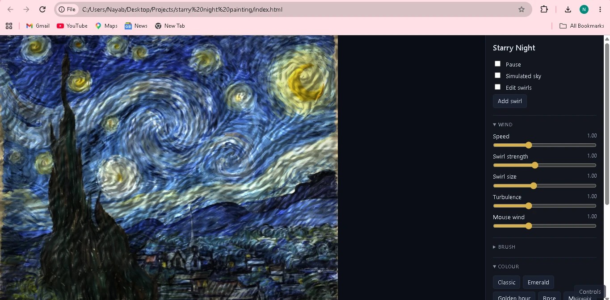
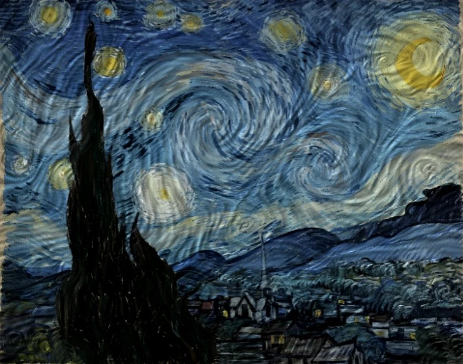
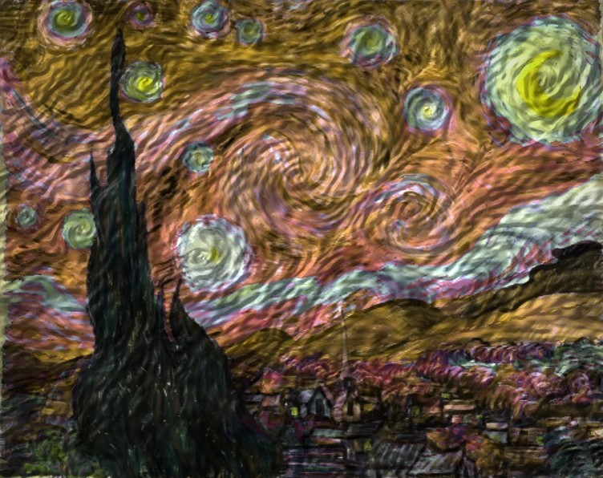

# Starry Night

Van Gogh's *The Starry Night* as a live, moving painting. A wind simulation drives the brushstrokes in
real time. You can move the swirls, blow the paint with the mouse and change the colours.

Runs in the browser on the graphics card (WebGL 2). Nothing to install.

## Screenshots

| Classic | Golden hour |
|---|---|
|  |  |

## Run

Double-click `Run Starry Night Live.bat` (or open `index.html`).
If the browser blocks local files, use `Serve Starry Night Live.bat` instead (needs Python).

## Use

- Move the mouse over the painting to blow the wind.
- **Edit swirls** (`E`): drag the circles, double-click the canvas to add one.
- **Simulated sky**: the sky colours come from the wind instead of the reference image.
- **Colour**: presets, plus sky and star hue.
- `S` saves a picture, `Space` pauses, `H` hides the panel. Double-click a slider's name to reset it.

## How it works

Each frame, four passes on the GPU (`src/shaders.js`):

1. **Flow.** A stream function built from vortices, a wind current and turbulence (amplitude falling as k^-4/3
   per octave, as in Kolmogorov's theory). Velocity is its curl, so the flow is incompressible.
2. **Colour.** The reference painting, or a sky generated from the flow.
3. **Brush.** Every pixel smears colour and bristle noise along the flow (line integral convolution).
4. **Paint.** The noise is lit as paint thickness, then colour grading.

Hills, bushes, village and cypress use fixed brush directions built from the reference by
`tools/build_scene.py`.

## Files

- `index.html`, `style.css`, `src/app.js`, `src/shaders.js`: the app
- `src/scene_data.js`: generated from `assets/reference.webp` by `tools/build_scene.py`
- `tools/build_scene.py` needs `pip install -r requirements.txt` (only to rebuild `scene_data.js`)

The layout and colours follow the real painting (public domain), so this is a re-rendering of it.
